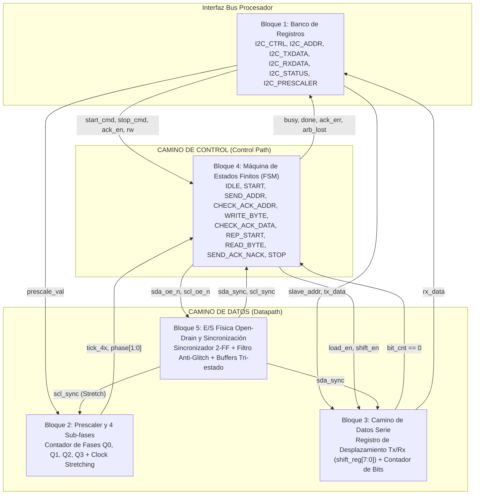
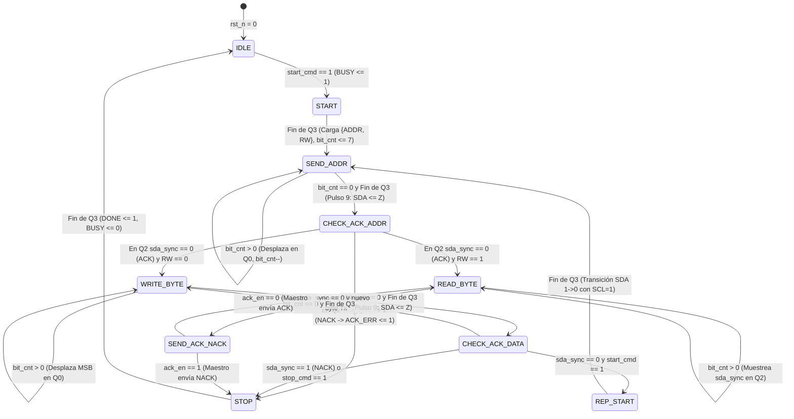

# Especificación y Arquitectura del Sistema: Periférico I2C_Master y Almacenamiento de Scores en EEPROM

---

## 1. Introducción y Propósito del Sistema
El presente repositorio implementa un bloque IP de hardware reutilizable correspondiente a un controlador maestro **$I^2C$ (*Inter-Integrated Circuit*)**, diseñado para integrarse como un periférico mapeado en memoria dentro de un System-on-Chip (SoC) basado en procesador (siguiendo la estructura de referencia de periféricos como `perip_blink.v`). 

Su función principal dentro del sistema general del videojuego es actuar como un puente de comunicación síncrona de alta confiabilidad para **almacenar y recuperar de forma no volátil las puntuaciones (*Scores*) de los jugadores en una memoria EEPROM externa** (ej. serie 24LCxx conectada en la dirección base `0x50`), liberando a la CPU de la gestión temporal bit a bit del protocolo.

---

## 2. Especificación Técnica y Restricciones (Criterio C1)

### 2.1. Definición de Interfaces, Entradas y Salidas (Pinout)
El periférico divide su interfaz en dos dominios: la **Interfaz del Bus del Sistema (Lado CPU)** y la **Interfaz Física del Bus $I^2C$ (Lado Externo)**.

| Señal | Dirección | Ancho | Dominio / Tipo | Descripción Funcional |
| :--- | :---: | :---: | :---: | :--- |
| **Interfaz del Bus del Procesador (SoC)** | | | | |
| `clk` | `input` | 1 bit | Reloj Sistema | Reloj principal del SoC (ej. $25\text{ MHz}$, $50\text{ MHz}$ o $100\text{ MHz}$) que sincroniza la FSM y el divisor de frecuencia. |
| `rst_n` | `input` | 1 bit | Reset (Activo Bajo) | Reinicio global asíncrono/síncrono; coloca los registros en su valor por defecto y libera el bus $I^2C$ (`1'bZ`). |
| `cs` | `input` | 1 bit | Control Bus | *Chip Select*: habilita el acceso al banco de registros del periférico cuando su dirección base es decodificada. |
| `wr` | `input` | 1 bit | Control Bus | Habilitación de escritura desde la CPU hacia el registro seleccionado por `addr`. |
| `rd` | `input` | 1 bit | Control Bus | Habilitación de lectura desde el registro seleccionado por `addr` hacia la CPU. |
| `addr` | `input` | 5 bits | Dirección Bus | Bus de direcciones local (`0x00` a `0x14`) para seleccionar uno de los 6 registros internos de 32 bits. |
| `wdata` | `input` | 32 bits | Datos Bus | Palabra de datos de 32 bits escrita por el procesador en los registros de configuración, dirección o transmisión. |
| `rdata` | `output` | 32 bits | Datos Bus | Palabra de datos de 32 bits leída por el procesador (datos recibidos desde la EEPROM o banderas de estado). |
| **Interfaz Física del Bus $I^2C$** | | | | |
| `sda` | `inout` | 1 bit | *Open-Drain* | Línea bidireccional de datos serie (*Serial Data*). Opera únicamente entre `1'b0` y alta impedancia (`1'bZ`). |
| `scl` | `inout` | 1 bit | *Open-Drain* | Línea bidireccional de reloj serie (*Serial Clock*). Generada por el maestro con soporte de *Clock Stretching*. |

### 2.2. Mapa de Memoria (*Memory Map*)
El periférico se mapea en el espacio de direcciones de 32 bits del procesador mediante 6 registros alineados a palabras de 4 bytes (`0x00` a `0x14`):

| Offset | Nombre del Registro | Acceso | Valor Reset | Descripción de Campos de Bits `[31:0]` |
| :---: | :--- | :---: | :---: | :--- |
| `0x00` | `I2C_CTRL` | R/W | `0x0000_0000` | **`[0] EN`**: Habilita el núcleo $I^2C$. **`[1] START_CMD`**: Dispara condición `START` / `Repeated START` y transmisión de dirección. **`[2] STOP_CMD`**: Solicita condición `STOP` al finalizar el byte actual. **`[3] ACK_EN`**: Respuesta del maestro en lectura (`0` = enviar ACK para continuar leyendo; `1` = enviar NACK en el último byte). **`[31:4]`**: Reservados (`0`). |
| `0x04` | `I2C_ADDR` | R/W | `0x0000_0000` | **`[0] RW`**: Operación (`0` = Escritura hacia esclavo, `1` = Lectura desde esclavo). **`[7:1] SLAVE_ADDR`**: Dirección de 7 bits del esclavo destino (ej. `7'b1010000` = `0x50` para EEPROM). **`[31:8]`**: Reservados (`0`). |
| `0x08` | `I2C_TXDATA` | R/W | `0x0000_0000` | **`[7:0] TX_BYTE`**: Byte de datos o dirección interna de memoria EEPROM a transmitir por `SDA` (orden MSB-first). **`[31:8]`**: Reservados (`0`). |
| `0x0C` | `I2C_RXDATA` | RO | `0x0000_0000` | **`[7:0] RX_BYTE`**: Último byte completo recibido desde el esclavo en una operación de lectura. **`[31:8]`**: Reservados (`0`). |
| `0x10` | `I2C_STATUS` | RO / W1C | `0x0000_0000` | **`[0] BUSY`** (RO): `1` mientras el bus está ocupado entre `START` y `STOP`. **`[1] DONE`** (RO/W1C): `1` al finalizar la transferencia de un byte o condición de parada. **`[2] ACK_ERR`** (RO/W1C): `1` si el esclavo responde con `NACK` (`SDA = 1`) en el 9.º pulso. **`[3] ARB_LOST`** (RO/W1C): `1` si se detecta pérdida de arbitraje en el bus. **`[31:4]`**: Reservados (`0`). |
| `0x14` | `I2C_PRESCALER` | R/W | `0x0000_007C` | **`[15:0] PRESCALE_VAL`**: Divisor de frecuencia para generar las 4 sub-fases por período de `SCL` ($\text{PRESCALER} = \frac{f_{CLK}}{4 \cdot f_{SCL}} - 1$). **`[31:16]`**: Reservados (`0`). |

### 2.3. Restricciones Técnicas y Capa Física
1. **Topología *Open-Drain* (Drenador Abierto):** Queda estrictamente prohibido inyectar un nivel alto activo (`1'b1` *push-pull*) en los pines `sda` y `scl` para prevenir cortocircuitos cuando un esclavo fuerza un `0` lógico. Las salidas conmutan exclusivamente entre `1'b0` y alta impedancia (`1'bZ`), requiriendo resistencias de *pull-up* externas ($R_p$ entre $2.2\text{ k}\Omega$ y $4.7\text{ k}\Omega$ a $3.3\text{ V}$) con capacitancia de bus $C_{bus} \le 400\text{ pF}$.
2. **Regla de Validez de Datos:** `SDA` solo puede cambiar de valor mientras `SCL = 0` (en la sub-fase $Q_0$) y debe permanecer estrictamente estable durante todo el pulso alto `SCL = 1` ($Q_2$ y $Q_3$), excepto en las condiciones de control `START`, `Repeated START` y `STOP`.
3. **Sincronización Anti-Metaestabilidad:** Las entradas físicas `sda_in` y `scl_in` pasan obligatoriamente por un sincronizador de doble Flip-Flop y un filtro de picos de ruido (*spike filter* de $50\text{ ns}$) antes de ser evaluadas por la lógica secuencial.
4. **Restricción Temporal de EEPROM:** Tras una operación de escritura de puntaje y la condición `STOP`, la memoria EEPROM requiere un tiempo interno de ciclo de escritura de página no volátil ($t_{WR} \le 5\text{ ms}$), lapso durante el cual no emite `ACK` a nuevas órdenes.

### 2.4. Manejo de Errores y Recuperación
* **Fallo de Reconocimiento (`ACK_ERR`):** Si en el 9.º pulso de `SCL` el maestro muestrea `sda_in == 1` (`NACK`), activa `ACK_ERR = 1`, aborta la trama y ejecuta automáticamente un `STOP` para liberar el bus.
* **Pérdida de Arbitraje (`ARB_LOST`):** Si durante la transmisión de un bit `1` el maestro detecta `sda_in == 0`, activa `ARB_LOST = 1`, pone sus pines en alta impedancia (`1'bZ`) y retorna a `IDLE`.

---

## 3. Modelo y Arquitectura del Sistema (Criterio C2)

### 3.1. Diagrama de Integración en el SoC y la Memoria EEPROM
El periférico se acopla al bus del procesador y controla el bus físico externo de 2 hilos:

```mermaid
graph LR
    subgraph SoC ["FPGA / System-on-Chip (SoC)"]
        CPU["Procesador (CPU)<br/>Ejecuta Juego + Driver i2c.c"]
        BUS["Bus del Sistema<br/>addr, wdata, rdata, cs, wr, rd"]
        
        subgraph PERIP ["Módulo Top: perip_i2c_master.v"]
            WRAP["Banco de Registros Mapeados<br/>(Memory Map 0x00 - 0x14)"]
            CORE["Núcleo: i2c_master_core.v<br/>(Control Path FSM + Datapath)"]
        end
        
        CPU <-->|Lectura/Escritura 32-bit| BUS
        BUS <-->|Mapa de Registros| WRAP
        WRAP <-->|Comandos / Datos / Flags| CORE
    end

    subgraph EXT ["Hardware Externo"]
        PULLUP["Resistencias Pull-Up (Rp)<br/>2.2 kΩ - 4.7 kΩ a 3.3V"]
        EEPROM["Memoria EEPROM I2C (0x50)<br/>Almacenamiento No Volátil de Scores"]
    end

    CORE <==>|"SDA (inout Open-Drain)"| PULLUP
    CORE <==>|"SCL (inout Open-Drain)"| PULLUP
    PULLUP <==>|"Bus Físico I2C"| EEPROM
```

### 3.2. Arquitectura Interna: *Datapath* vs. *Control Path*
El diseño interno desglosa sus componentes en dos grandes dominios funcionales:

* **Camino de Datos (*Datapath*):** Comprende el Banco de Registros (Bloque 1), el Generador de Reloj de 4 Fases (Bloque 2), el Registro de Desplazamiento y Contador de Bits (Bloque 3) y la circuitería física de entrada/salida (Bloque 5).
* **Camino de Control (*Control Path*):** Conformado por la Máquina de Estados Finitos (FSM - Bloque 4), la cual interpreta las banderas de estatus del datapath y emite las señales de control de la transferencia.

### 3.3. Diagrama de Estados FSM a Nivel RTL
Las transiciones del núcleo lógico coinciden exactamente con los estados de la máquina de estados en Verilog:

---

## 4. Almacenamiento, Guardado y Recuperación de Puntuaciones (*Scores*)

### 4.1. ¿Dónde se almacena el Score?
El puntaje del juego posee dos niveles de almacenamiento:
1. **Volátil (RAM del Procesador):** Durante el transcurso de la partida, la puntuación se actualiza en tiempo real en registros y variables alojadas en la memoria RAM interna del procesador SoC.
2. **No Volátil (Memoria EEPROM Externa 24LCxx):** Al finalizar la partida, el puntaje es transferido mediante el periférico `perip_i2c_master` hacia una memoria EEPROM externa conectada en la dirección `0x50`, garantizando que los récords persistan aunque el sistema se apague.

### 4.2. ¿Cómo se guarda el Score? (Secuencia de Escritura)
Cuando el juego termina, el firmware en C invoca al driver `i2c.c` para realizar una transacción de escritura por ráfaga (*Byte/Page Write*):
1. **Disparo START:** La CPU configura `I2C_ADDR = 0x50` con bit $R/\bar{W} = 0$ (Escritura) y activa `START_CMD = 1`.
2. **Envío de Dirección de Memoria Interna:** Escribe en `I2C_TXDATA` la dirección de celda dentro de la EEPROM donde se guardará el puntaje y espera `DONE = 1`.
3. **Envío de Bytes del Puntaje:** Envía secuencialmente los bytes que componen la variable del *Score* (ej. 2 o 4 bytes) depositándolos en `I2C_TXDATA`.
4. **Condición STOP y Espera de Grabación:** El firmware ordena `STOP_CMD = 1`. Tras el `STOP`, el software aguarda el tiempo de ciclo interno de escritura de la EEPROM ($t_{WR} \le 5\text{ ms}$).

### 4.3. ¿Cómo se recupera el Score para mostrarlo en pantalla?
Para mostrar la tabla de mejores puntajes en la interfaz gráfica, el procesador recupera la información ejecutando una **Transacción Combinada con Repeated START**:
1. **Fase de Apuntamiento (Escritura de Dirección):** El maestro emite `START`, direcciona la EEPROM con $R/\bar{W} = 0$ y envía el byte de dirección de celda del puntaje.
2. **Cambio de Modo (Repeated START):** Sin liberar el bus, el maestro emite un `Repeated START` (`START_CMD = 1`), direcciona nuevamente la EEPROM (`0x50`) pero con bit $R/\bar{W} = 1$ (Lectura).
3. **Lectura de Datos y Master NACK:** El hardware recibe los bytes del puntaje y los entrega a la CPU a través de `I2C_RXDATA`. Para el último byte leído, el maestro responde con un `NACK` (`ACK_EN = 1`) y emite la condición `STOP`.
4. **Despliegue en Pantalla:** La CPU toma el valor recuperado de `I2C_RXDATA` y lo envía al controlador gráfico para renderizar el puntaje en la pantalla.

---

## 5. Partición Hardware-Software y Análisis de Alternativas

### 5.1. Partición Hardware-Software (*HW/SW Partitioning*)
| Subsistema | Responsabilidad Asignada | Justificación Técnica |
| :--- | :---: | :--- |
| **Hardware** (`perip_i2c_master.v` + `i2c_master_core.v`) | Generación de reloj `SCL` y cuadrantes $Q_0\text{–}Q_3$, serialización/deserialización MSB-first de 8 bits, conteo del pulso 9 (`ACK/NACK`), sincronización y control *Open-Drain*. | Requiere precisión determinista a nivel de microsegundos sin bloquear el ciclo de instrucciones de la CPU. |
| **Software** (`i2c.c`, `i2c.h` y Aplicación) | Configuración del `PRESCALER`, segmentación del *Score* en bytes, direccionamiento de celdas de la EEPROM, control de tiempos $t_{WR}$ y lógica de renderizado en pantalla. | Otorga flexibilidad para modificar estructuras de datos o protocolos de visualización sin resintetizar la FPGA. |

### 5.2. Análisis de Alternativas Arquitectónicas
* **Periférico Hardware RTL (Elegida) vs. *Bit-Banging* por Software:** Descarga a la CPU de retardos bloqueantes de $\sim 90\text{ }\mu\text{s}$ por byte, garantizando márgenes temporales estrictos para el bus $I^2C$.
* **Diseño Síncrono con Habilitación de 4 Fases `tick_4x` (Elegida) vs. Relojes Múltiples:** Opera 100% bajo un único dominio de reloj (`clk`), evitando problemas de cruce de dominios (*CDC*) y garantizando estabilidad en el muestreo.
* **Protocolo $I^2C$ de 2 Hilos (Elegida) vs. SPI:** Optimiza el uso de pines en la FPGA a solo 2 líneas (`SDA`, `SCL`) y provee confirmación nativa de recepción (`ACK/NACK`) ideal para memorias de almacenamiento de puntajes.

---

## 6. Criterios de Aceptación Verificables (Checklist para el Jueves)
* [ ] **CA-01:** Las formas de onda en simulación (`GTKWave`) confirman operación puramente *Open-Drain* en `SDA` y `SCL`.
* [ ] **CA-02:** Con el `PRESCALER` configurado, la frecuencia de `SCL` se estabiliza exactamente en $100\text{ kHz} \pm 1\%$.
* [ ] **CA-03:** El módulo detecta esclavos ausentes levantando la bandera `ACK_ERR = 1` y ejecutando `STOP`.
* [ ] **CA-04:** Se logra escribir y leer exitosamente una puntuación de prueba en la EEPROM mediante transacción combinada.